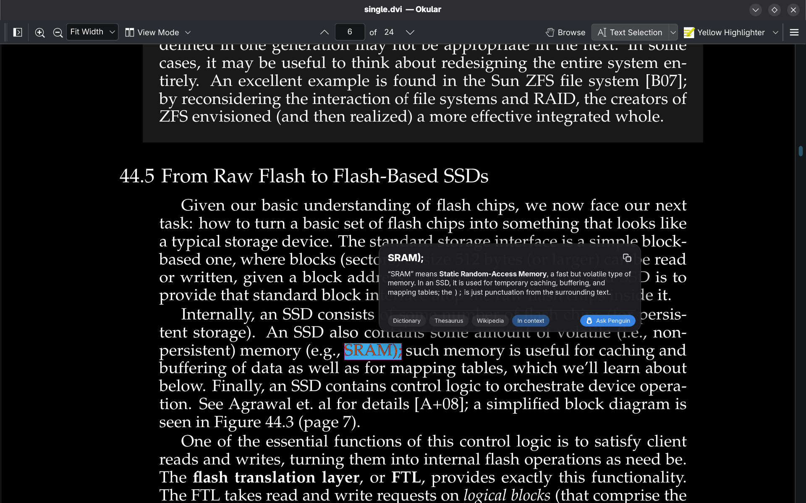
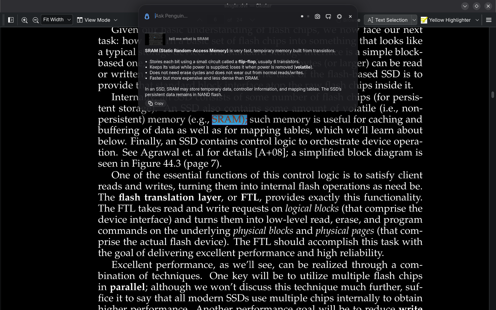
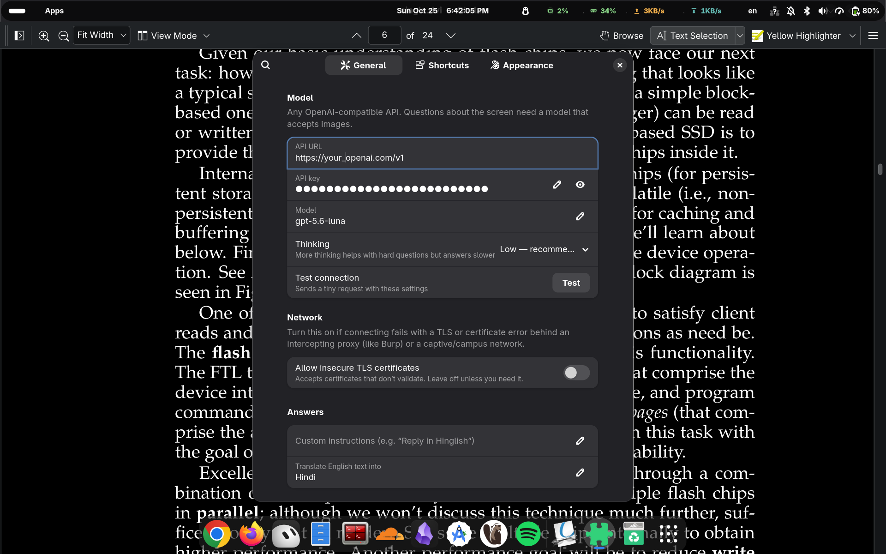
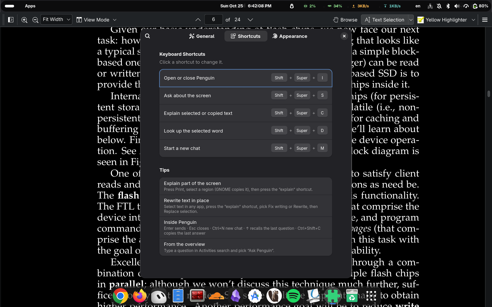
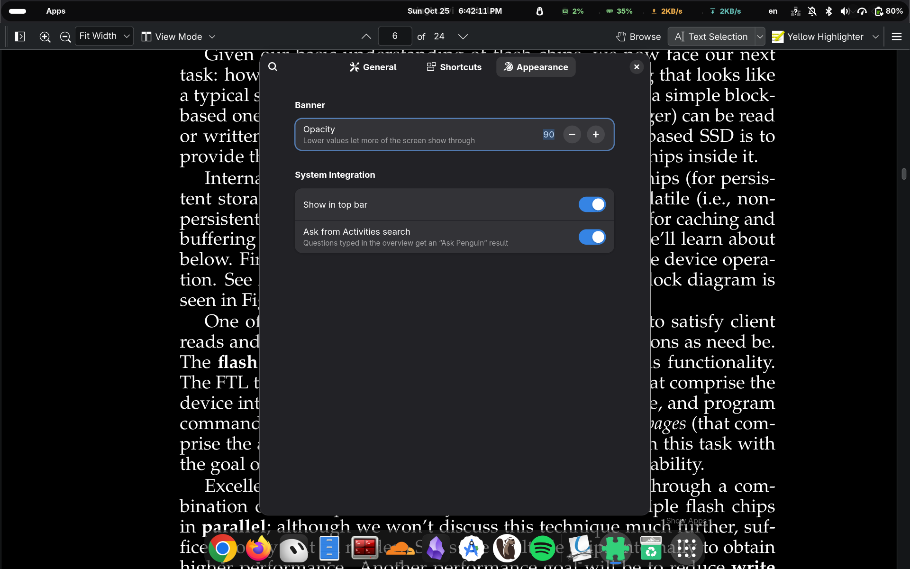

# Penguin

An AI assistant for GNOME Shell. Ask a question, ask about your screen or the text you selected, and look up words from any app.

Penguin works out of the box on a free tier, or with any OpenAI-compatible API and your own key.

Website: [penguin.zenbleed.tech](https://penguin.zenbleed.tech/)











## Install

Penguin needs GNOME Shell 50.

```bash
./install.sh
```

This installs the extension, the `penguin` command, a launcher, and the offline dictionary that Look Up uses. Log out and back in, then press **Super+I**.

A copy from extensions.gnome.org contains only the extension. The command, launcher and offline dictionary come from `./install.sh`.

## Free tier

By default Penguin uses Gemma 4 through `penguin.zenbleed.tech`, a proxy run by the author, with [Sarvam AI](https://www.sarvam.ai/) behind it. On first use Penguin creates a random key for your install. You don't need an account.

Daily limits apply per install, per IP address and in total. They reset at midnight IST.

## Use your own API

In preferences, set **Provider** to **Custom** and enter the API URL, key and model of any OpenAI-compatible service. Screen questions need a model that accepts images. Your key is never sent to the free tier, and switching back keeps your custom settings.

To set a custom provider at install time:

```bash
PENGUIN_API_KEY=sk-... ./install.sh
PENGUIN_API_URL=https://example.com/v1 PENGUIN_MODEL=some-model PENGUIN_API_KEY=... ./install.sh
```

## Privacy

Penguin sends something only when you ask: your question, the selected or copied text, and a screenshot for screen questions. It goes to the API in your settings. On the free tier that is `penguin.zenbleed.tech` (behind Cloudflare), which forwards it to Sarvam AI. The free-tier server keeps the time, IP address, install key id and token counts for 31 days to enforce the limits. It does not store questions, answers or screenshots.

## Shortcuts

| Action | Default |
| --- | --- |
| Open or close Penguin | Super+I |
| Ask about the screen | Shift+Super+S |
| Explain selected or copied text | not set |
| Look up the selected word | not set |
| New chat | Shift+Super+N |

Set the two selection shortcuts in preferences. To also list Penguin's shortcuts in **Settings → Keyboard → View and Customize Shortcuts**, run `./system-integration.sh`. It asks for your password once.

## Command line

```
penguin              # open or close
penguin ask …        # open and ask
penguin screen       # ask about the screen
penguin selection    # explain selection or clipboard
penguin lookup       # look up the selected word
penguin new          # start a new chat
penguin prefs        # open preferences
```

## Uninstall

```bash
./uninstall.sh           # keep settings
./uninstall.sh --purge   # also erase settings, including API keys
```

## Develop

`dev/test-shell.sh` runs a headless GNOME Shell with its own D-Bus and dconf, so you can try changes without logging out:

```bash
dev/test-shell.sh start
dev/test-shell.sh eval '…'
dev/test-shell.sh stop
```

To build the zip for extensions.gnome.org:

```bash
gnome-extensions pack extension --extra-source=lib --extra-source=icons --force -o .
```

## License

GPL-2.0-or-later. Look Up's offline dictionary is [Open English WordNet](https://en-word.net/) (CC BY 4.0), downloaded at install time.
